# Patient360

<p align="center">
  
</p>

<p align="center">
  <strong>Evidence-Grounded Healthcare Intelligence &amp; Clinical Knowledge Synthesis Platform</strong>
</p>

<p align="center">
  <a href="https://patient360-frontend-442154825091.us-central1.run.app"></a>
  <a href="https://patient360-backend-442154825091.us-central1.run.app/docs"></a>
  <a href="https://github.com/Yanshuptl18/Patient360/blob/main/LICENSE"></a>
  <a href="https://python.org"></a>
  <a href="https://react.dev"></a>
  <a href="https://fastapi.tiangolo.com"></a>
</p>

---

## Welcome to Patient360

In modern healthcare, patient data is often scattered across dozens of disconnected PDF files, discharge summaries, laboratory panels, and medical notes. Clinicians spend valuable hours piecing together timelines and verifying disparate facts, while risk managers worry about ungrounded assertions or overlooked contradictions.

**Patient360** brings fragmented medical evidence into a unified, evidence-grounded clinical workspace. 

Every summary, timeline event, and answer generated by Patient360 is tied directly to physical page numbers, document identifiers, and verbatim source passages from uploaded medical records. When records do not contain sufficient evidence to answer an inquiry, the platform clearly abstains rather than speculating.

---

## Quick Links

- **Live Web Application**: [https://patient360-frontend-442154825091.us-central1.run.app](https://patient360-frontend-442154825091.us-central1.run.app)
- **Interactive API Documentation**: [https://patient360-backend-442154825091.us-central1.run.app/docs](https://patient360-backend-442154825091.us-central1.run.app/docs)
- **Service Diagnostics**: [https://patient360-backend-442154825091.us-central1.run.app/api/v1/health](https://patient360-backend-442154825091.us-central1.run.app/api/v1/health)
- **Source Code Repository**: [https://github.com/Yanshuptl18/Patient360](https://github.com/Yanshuptl18/Patient360)

> **Quick Demo Access**: Visitors can select any of the five preconfigured user personas on the login page (Doctor, Nurse, Hospital Admin, Patient, System Admin) to enter tailored workspaces instantly without registration or passwords.

---

## Clinical Notice and Disclaimer

Patient360 is an informational retrieval and synthesis platform intended for clinical research, care coordination workflows, and administrative review. It is not an FDA-cleared medical device, autonomous diagnostic system, or prescribing mechanism, and does not replace professional clinical judgment. All summaries, timeline extractions, and citations must be independently reviewed by licensed healthcare professionals against primary source records before clinical decisions are made.

---

## Table of Contents

- [Core Capabilities](#core-capabilities)
- [Role-Based Workspaces](#role-based-workspaces)
- [System Architecture](#system-architecture)
- [Feature Implementation Status](#feature-implementation-status)
- [Technology Stack](#technology-stack)
- [Local Development Setup](#local-development-setup)
- [Docker Multi-Container Setup](#docker-multi-container-setup)
- [Security and Patient Data Isolation](#security-and-patient-data-isolation)
- [Troubleshooting](#troubleshooting)
- [License](#license)

---

## Core Capabilities

### 1. Medical Document Management
- Ingests clinical PDF records, discharge summaries, laboratory panels, and scientific papers up to 25 MB.
- Assigns tamper-evident SHA-256 cryptographic hashes for document integrity and deduplication.
- Preserves physical page numbers, tabular values, clinical units (e.g., mg/dL, mmHg), and medical abbreviations.

### 2. Evidence-Grounded Question Answering
- Enables authorized clinicians to ask targeted clinical questions about an assigned patient's records.
- Every claim is anchored to exact physical page numbers, document identifiers, and verbatim excerpts.
- Features built-in PDF viewer integration to inspect original source passages directly.
- Plainly abstains ("Insufficient evidence documented in available records") when documents do not substantiate an assertion, preventing ungrounded speculation.

### 3. Medical History Timeline
- Automatically organizes clinical events chronologically across diagnoses, medications, procedures, encounters, and laboratory results.
- Distinguishes event occurrence dates from document recording dates.
- Detects cross-document contradictions (e.g., documented "No Known Drug Allergies" conflicting with active penicillin prescriptions, or quantitative ejection fraction disparities).

### 4. Clinical Research Assistant
- Structured multi-step investigation workflow for complex clinical inquiries.
- Displays transparent progress across evidence retrieval, cross-referencing, and draft preparation.
- Enforces a mandatory clinical review gate: reports cannot be finalized without explicit human clinician approval.

### 5. Biomedical Research Workspace
- Extracts Population, Intervention, Comparator, and Outcomes (PICO) parameters from published clinical trials and guidelines.
- Generates side-by-side comparative matrices across multiple publications.
- Exports structured evidence summaries in Markdown format for clinical review committees.

---

## Role-Based Workspaces

Patient360 provides tailored workspaces for five distinct healthcare user types:

| Role Name | Primary Clinical Tasks | Access Boundary |
| :--- | :--- | :--- |
| **Doctor** | Comprehensive patient dossier review, question answering, timeline examination, research assistant workflows. | All authorized patients in the department. |
| **Nurse / Care Coordinator** | Patient vital and care event monitoring, medication schedules, conflicting documentation alerts. | Assigned care cohort records. |
| **Hospital Administrator** | Facility census oversight, document throughput tracking, record integrity audits. | Facility-wide governance and audit logs. |
| **Patient** | Personal health records, care timeline, questions about personal documents. | Strictly isolated to personal records (Eleanor Vance). |
| **System Administrator** | Service health status, quality testing benchmarks, security configuration. | System configuration and diagnostic telemetry. |

---

## System Architecture

```text
+=============================================================================================+
|                                  1. CLIENT & PRESENTATION TIER                              |
|  * React 18 Single-Page Application (TypeScript)     * Tailored Clinical Workspaces         |
|  * Light Healthcare Design System (WCAG AA Compliant)* In-Browser Evidence Citation Viewer  |
|  * Medical History Timeline & Conflict Viewer        * One-Click Role Selector (Demo Mode)  |
+=============================================================================================+
                                              |
                                     HTTPS / TLS (Port 443)
                                              v
+=============================================================================================+
|                               2. INGRESS & REVERSE PROXY TIER                               |
|  * Google Cloud Run Ingress / Nginx Proxy           * Strict Security Headers               |
|  * Static Asset Compression & Caching               * Rate Limiting & Request Sanitization  |
+=============================================================================================+
                                              |
                                     Internal HTTP (Port 8080)
                                              v
+=============================================================================================+
|                              3. FASTAPI BACKEND GATEWAY LAYER                               |
|  * JWT Authentication & Token Lifecycle             * Role-Based Access Control (5 Roles)   |
|  * Server-Side Patient Tenant Isolation Middleware  * Pydantic v2 Schema Validation         |
|  * Emergency Acute Symptom Guardrails               * Audit Logger with Credential Masking  |
+=============================================================================================+
                                              |
                                              v
+=============================================================================================+
|                         4. CLINICAL INTELLIGENCE & DOMAIN SERVICES                          |
|                                                                                             |
|  +---------------------------------+  +---------------------------------+                   |
|  |     HYBRID RETRIEVAL ENGINE     |  |   CLINICAL TIMELINE & CONFLICT  |                   |
|  | * Dense FastEmbed (384-d CPU)   |  | * Temporal Event Extraction     |                   |
|  | * Sparse Okapi BM25 Search      |  | * Event vs Document Date Split  |                   |
|  | * Reciprocal Rank Fusion (k=60) |  | * Cross-Document Contradictions |                   |
|  +---------------------------------+  +---------------------------------+                   |
|                                                                                             |
|  +---------------------------------+  +---------------------------------+                   |
|  |   RESEARCH ASSISTANT WORKFLOW   |  |   CITATION & SAFETY VERIFIER    |                   |
|  | * Bounded State Machine (Max 5) |  | * Claim-to-Quote Verification   |                   |
|  | * 30-Second Execution Limit     |  | * Insufficient-Evidence Notice  |                   |
|  | * Mandatory Human Review Gate   |  | * Acute Clinical Warning Scan   |                   |
|  +---------------------------------+  +---------------------------------+                   |
+=============================================================================================+
                                              |
                         +--------------------+--------------------+
                         v                                         v
+================================================+ +==========================================+
|         5. DATA PERSISTENCE TIER               | |     6. FOUNDATION MODEL GATEWAY          |
|  * Relational Database (PostgreSQL / SQLite):  | |  * Hosted Google Gemini API:             |
|    Patients, Documents, Events, Audit Logs     | |    gemini-flash-latest, 3.5-flash-lite   |
|  * Vector Storage (Qdrant Cloud / Embedded):   | |  * Local Offline Ollama Engine:          |
|    384-dimensional Index with Tenant Filters   | |    qwen3:4b (offline development)        |
|  * Document Storage (Local Disk / Cloud Store):| |  * Deterministic Mock Provider:          |
|    Tamper-Evident SHA-256 PDF Archive          | |    Automated Testing & Cost-Free Demo    |
+================================================+ +==========================================+
```

---

## Feature Implementation Status

| Feature Domain | Capability |
| :--- | :--- |
| **Authentication** | JWT Authentication, Argon2 Hashing, Token Refresh |
| **Demo Access** | One-Click Demo Role Selector (5 User Personas) |
| **Patient Isolation** | Server-side database & vector payload filtering |
| **Document Ingestion** | PDF parsing, physical page coordinates, SHA-256 hash |
| **Hybrid Search** | FastEmbed 384-d dense vectors + Okapi BM25 + RRF |
| **Evidence QA** | Grounded question answering with page-level citations |
| **Citation Verifier** | Verbatim claim-to-quote source text matching |
| **Abstention** | Plain "insufficient evidence" handling |
| **Clinical Timeline** | Chronological event extraction (diagnoses, meds, labs) |
| **Contradictions** | Cross-document conflicting information detection |
| **Biomedical Studies** | PICO parameter extraction and cross-study matrix |
| **Research Assistant** | Multi-step bounded investigation with review gates |
| **Service Status** | Real-time health check endpoint (`/api/v1/health`) |

---

## Technology Stack

- **Frontend:** React 18, TypeScript, Tailwind CSS, Lucide Icons, Vite.
- **Backend:** Python 3.11, FastAPI, Pydantic v2, SQLAlchemy 2.0.
- **Document Processing:** PyMuPDF (`fitz`) for PDF extraction.
- **Vector Search:** Qdrant (supports cloud cluster and embedded local mode).
- **Embeddings:** FastEmbed with `BAAI/bge-small-en-v1.5` running on CPU (with offline deterministic unit fallback).
- **Keyword Search:** In-memory Okapi BM25 with clinical acronym preservation.
- **Rank Fusion:** Reciprocal Rank Fusion (RRF, $k=60$).
- **Workflow State Machine:** LangGraph deterministic state machine with loop iteration limits.
- **Relational Storage:** PostgreSQL 16 (with automatic local SQLite fallback).
- **Monitoring:** Prometheus telemetry metrics exposition at `/metrics`.

---

## Local Development Setup

### Prerequisites

- Python 3.11 or higher
- Node.js 18 or 20
- Git

### 1. Clone Repository & Setup Backend Environment

**Windows (PowerShell):**
```powershell
git clone https://github.com/Yanshuptl18/Patient360.git
cd Patient360

python -m venv .venv
.\.venv\Scripts\activate

pip install -r requirements.txt
```

**Linux / macOS:**
```bash
git clone https://github.com/Yanshuptl18/Patient360.git
cd Patient360

python3.11 -m venv .venv
source .venv/bin/activate

pip install -r requirements.txt
```

### 2. Configure Environment Variables

Copy `.env.example` to `.env`:
```bash
cp .env.example .env
```

### 3. Seed Demonstration Data

```bash
python scripts/seed_demo_data.py
```

### 4. Run the Application

**Terminal 1: Backend API**
```bash
uvicorn backend.main:app --host 127.0.0.1 --port 8000 --reload
```
API documentation is available at `http://localhost:8000/docs` and service health at `http://localhost:8000/api/v1/health`.

**Terminal 2: Frontend Single-Page Application**
```bash
cd frontend
npm install
npm run dev
```
Open `http://localhost:5173` in your browser.

---

## Docker Multi-Container Setup

To run the complete production container stack locally:

```bash
docker-compose -f deployment/docker-compose.prod.yml up -d
```

### Containers in Stack

| Container | Image / Base | Internal Port | Host Port | Purpose |
| :--- | :--- | :--- | :--- | :--- |
| `frontend` | Node multi-stage -> Nginx | 80 | 80 | Serves optimized React application bundle |
| `backend` | Python 3.11-slim | 8000 | 8000 | FastAPI REST service and intelligence pipelines |
| `postgres` | postgres:16-alpine | 5432 | 5432 | Relational store for users, records, timelines |
| `qdrant` | qdrant/qdrant:v1.8.4 | 6333 | 6333 | Vector database for semantic evidence retrieval |

To view logs:
```bash
docker-compose -f deployment/docker-compose.prod.yml logs -f
```

To stop:
```bash
docker-compose -f deployment/docker-compose.prod.yml down
```

---

## Security and Patient Data Isolation

1. **Server-Enforced Patient Isolation:**
   - Authorization is enforced at the database query and vector search payload filter levels.
   - Patient users (e.g., Eleanor Vance) are strictly restricted to their own synthetic record ID (`SYNTH-10001`).
   - Modifying request parameters, IDs, or query text cannot bypass server-side tenant isolation.

2. **Verifiable Data Provenance:**
   - Every ingested document is assigned an immutable SHA-256 cryptographic hash.
   - All AI answers link directly to original document IDs, physical page numbers, and verbatim source passages.

3. **Protection of Secrets:**
   - All API keys, tokens, and database passwords are kept on the server and loaded via environment variables.
   - Frontend bundles contain zero embedded secrets.

4. **Responsible Clinical Safety Guardrails:**
   - Acute symptom queries (e.g., cardiac arrest, acute chest pain) trigger immediate emergency care advisories.
   - The platform clearly states that it does not provide autonomous clinical diagnoses or prescribe treatments.

---

## Troubleshooting

| Problem | Cause | Solution |
| :--- | :--- | :--- |
| `Cannot connect to PostgreSQL` | Database container or server not running. | The platform will automatically fall back to local SQLite (`patient360_dev.db`). For PostgreSQL, run `docker-compose up -d postgres`. |
| `Qdrant connection refused` | Vector store service offline. | The system falls back to embedded vector search. To use external Qdrant, run `docker-compose up -d qdrant`. |
| `Missing Gemini API key` | `GEMINI_API_KEY` not configured. | Set your key in `.env` or leave `LLM_PROVIDER=mock` for testing. |
| `File upload rejected (Over 25 MB)`| File exceeds maximum size threshold. | Ensure uploaded documents are clinical PDFs under 25 MB. |

---

## License

Patient360 is licensed under the [MIT License](LICENSE).
Synthetic patient records and landmark clinical trial citations are modeled on published clinical literature for research and educational demonstrations.
