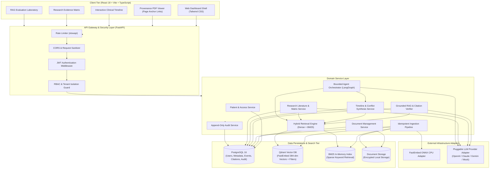
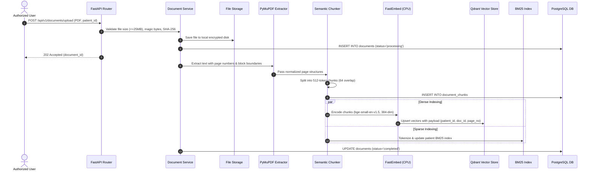
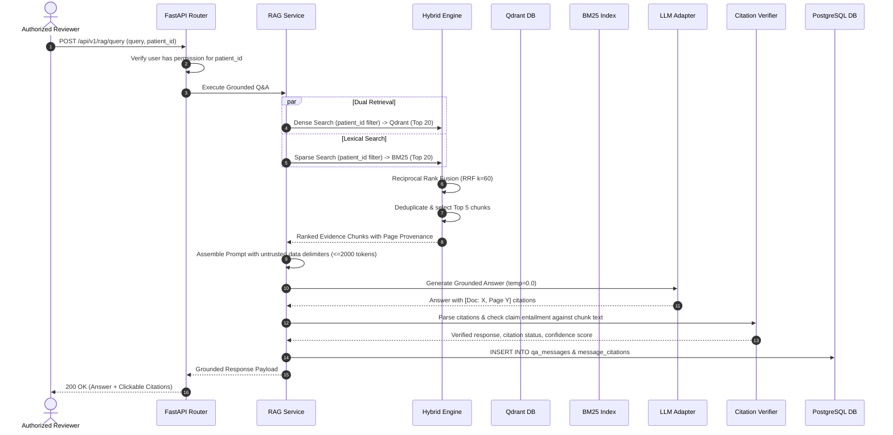
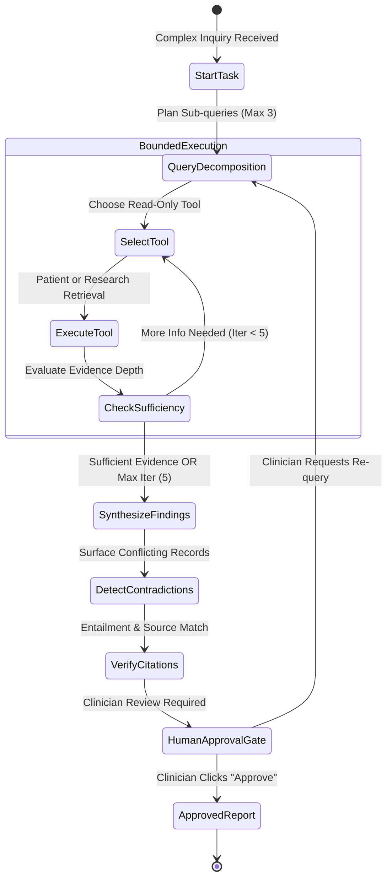

# Patient360: System Architecture Specification

## 1. Architectural Philosophy and Design Principles
Patient360 follows the principles of **Clean Architecture** and **Domain-Driven Design (DDD)**:
1. **Separation of Concerns:** Business logic is decoupled from API controllers, database persistence, and external AI providers.
2. **Dependency Inversion:** High-level policy modules (RAG orchestration, clinical timeline synthesis) depend on abstractions (`BaseLLMProvider`, `BaseEmbeddingProvider`), not vendor implementations.
3. **Stateless API Gateway:** FastAPI route handlers perform authentication, validation, and delegation to domain services, maintaining no internal session state.
4. **Defense in Depth:** Security, tenant isolation, and audit logging are enforced at the service, database, and vector layers.
5. **Deterministic AI Operations:** AI components are bound by deterministic temperature (0.0), token budgets, structural prompts, and post-generation citation validation.

---

## 2. System Architecture Diagram

---

## 3. Core Component Boundaries & Subsystems

### 3.1 Backend Modular Structure
* `backend/core/`: Configuration settings (Pydantic Settings), database engine, logging configuration, security utilities, and base exception handlers.
* `backend/auth/`: JWT credential validation, password hashing, and role permission dependencies.
* `backend/patients/`: Patient demographic CRUD, panel assignments, and authorization verification.
* `backend/documents/`: File upload validation, MIME checking, SHA-256 deduplication, and encrypted local file storage.
* `backend/ingestion/`: Text extraction via PyMuPDF, clinical text normalization, semantic sliding-window chunking, and metadata attribution.
* `backend/embeddings/`: Abstract `BaseEmbeddingProvider` and local CPU FastEmbed implementation.
* `backend/retrieval/`: Qdrant client wrapper, in-memory BM25 lexical index, and Reciprocal Rank Fusion (RRF) algorithm.
* `backend/rag/`: Prompt assembly with delimiter boundaries, abstract `BaseLLMProvider`, response parser, and N-gram citation verifier.
* `backend/timeline/`: Clinical event extraction (Diagnoses, Medications, Encounters, Labs), date reconciliation, and contradiction detection.
* `backend/research/`: Biomedical study parameter extraction, comparative matrix generator, and dossier report exporter.
* `backend/agents/`: LangGraph state machine, tool definitions with explicit authorization schemas, iteration guards, and human approval checkpoints.
* `backend/audit/`: Sanitized, append-only security and operational audit trail.
* `backend/evaluation/`: Automated benchmark test runner, metric calculators (Recall, MRR, Faithfulness, Citation Precision).

---

## 4. End-to-End Pipeline Flows

### 4.1 Document Ingestion Flow

### 4.2 Hybrid Retrieval and Grounded RAG Flow

---

## 5. Agentic Workflow Architecture

---

## 6. Deployment and Infrastructure Overview
* **Multi-Container Compose:** Runs PostgreSQL and Qdrant in Docker with resource caps suitable for local Windows 16 GB machines.
* **Local Backend Service:** Python 3.11 virtual environment executing Uvicorn with async worker processes.
* **Local Frontend Service:** Vite dev server executing React 18 with Hot Module Replacement.
* **Production Path:** Multi-stage Docker builds compiling frontend to static assets served via Nginx reverse proxy routing `/api/` to Gunicorn/Uvicorn backend workers.
