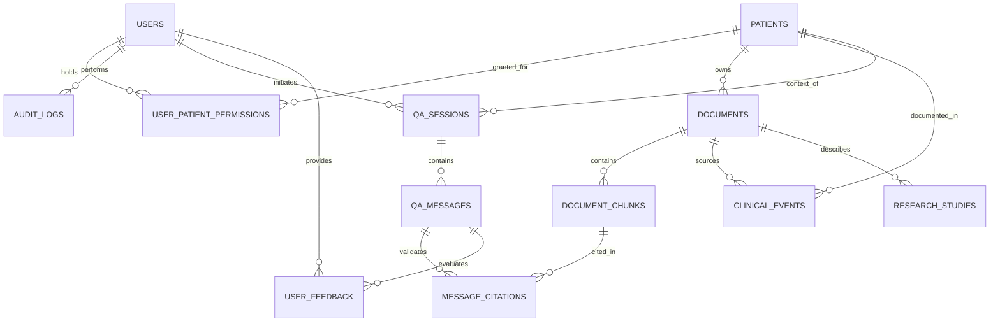

# Patient360: Data Model and Storage Specification

## 1. Overview
Patient360 uses a dual-storage data persistence architecture:
1. **Relational Database (PostgreSQL 16):** Stores structured entities, relational links, access permissions, clinical timelines, Q&A message history, citations, and append-only audit records.
2. **Vector Database (Qdrant):** Stores dense vector representations of document chunks alongside rich metadata payloads for filtered similarity retrieval.

---

## 2. Entity Relationship Diagram (ERD)



---

## 3. Relational Database Schema (PostgreSQL)

### 3.1 Users and Authentication
```sql
CREATE TABLE users (
    id UUID PRIMARY KEY DEFAULT gen_random_uuid(),
    email VARCHAR(255) UNIQUE NOT NULL,
    hashed_password VARCHAR(255) NOT NULL,
    full_name VARCHAR(255) NOT NULL,
    role VARCHAR(50) NOT NULL CHECK (role IN ('admin', 'reviewer', 'researcher', 'demo')),
    is_active BOOLEAN NOT NULL DEFAULT TRUE,
    created_at TIMESTAMPTZ NOT NULL DEFAULT NOW(),
    updated_at TIMESTAMPTZ NOT NULL DEFAULT NOW()
);
CREATE INDEX idx_users_email ON users(email);
```

### 3.2 Patients and Access Permissions
```sql
CREATE TABLE patients (
    id UUID PRIMARY KEY DEFAULT gen_random_uuid(),
    mrn_synthetic VARCHAR(64) UNIQUE NOT NULL,
    first_name VARCHAR(100) NOT NULL,
    last_name VARCHAR(100) NOT NULL,
    date_of_birth DATE NOT NULL,
    gender VARCHAR(20) NOT NULL,
    primary_condition VARCHAR(255),
    is_deleted BOOLEAN NOT NULL DEFAULT FALSE,
    created_at TIMESTAMPTZ NOT NULL DEFAULT NOW(),
    updated_at TIMESTAMPTZ NOT NULL DEFAULT NOW()
);
CREATE INDEX idx_patients_mrn ON patients(mrn_synthetic);

CREATE TABLE user_patient_permissions (
    id UUID PRIMARY KEY DEFAULT gen_random_uuid(),
    user_id UUID NOT NULL REFERENCES users(id) ON DELETE CASCADE,
    patient_id UUID NOT NULL REFERENCES patients(id) ON DELETE CASCADE,
    permission_level VARCHAR(20) NOT NULL CHECK (permission_level IN ('read', 'write', 'admin')),
    granted_at TIMESTAMPTZ NOT NULL DEFAULT NOW(),
    UNIQUE(user_id, patient_id)
);
CREATE INDEX idx_perm_user_patient ON user_patient_permissions(user_id, patient_id);
```

### 3.3 Documents and Chunks
```sql
CREATE TABLE documents (
    id UUID PRIMARY KEY DEFAULT gen_random_uuid(),
    patient_id UUID REFERENCES patients(id) ON DELETE SET NULL, -- NULL for research literature
    title VARCHAR(255) NOT NULL,
    file_path VARCHAR(512) NOT NULL,
    file_hash_sha256 VARCHAR(64) NOT NULL,
    file_size_bytes BIGINT NOT NULL,
    mime_type VARCHAR(100) NOT NULL,
    doc_type VARCHAR(50) NOT NULL CHECK (doc_type IN ('patient_record', 'lab_report', 'discharge_summary', 'research_paper', 'clinical_guideline')),
    doc_date DATE,
    ingestion_status VARCHAR(30) NOT NULL DEFAULT 'pending' CHECK (ingestion_status IN ('pending', 'processing', 'completed', 'failed')),
    error_message TEXT,
    version INT NOT NULL DEFAULT 1,
    is_deleted BOOLEAN NOT NULL DEFAULT FALSE,
    created_at TIMESTAMPTZ NOT NULL DEFAULT NOW(),
    updated_at TIMESTAMPTZ NOT NULL DEFAULT NOW()
);
CREATE INDEX idx_documents_patient ON documents(patient_id);
CREATE INDEX idx_documents_hash ON documents(file_hash_sha256);
CREATE INDEX idx_documents_status ON documents(ingestion_status);

CREATE TABLE document_chunks (
    id UUID PRIMARY KEY DEFAULT gen_random_uuid(),
    document_id UUID NOT NULL REFERENCES documents(id) ON DELETE CASCADE,
    chunk_index INT NOT NULL,
    page_number INT NOT NULL,
    content TEXT NOT NULL,
    token_count INT NOT NULL,
    metadata_json JSONB NOT NULL DEFAULT '{}',
    created_at TIMESTAMPTZ NOT NULL DEFAULT NOW(),
    UNIQUE(document_id, chunk_index)
);
CREATE INDEX idx_chunks_doc_page ON document_chunks(document_id, page_number);
```

### 3.4 Longitudinal Clinical Events
```sql
CREATE TABLE clinical_events (
    id UUID PRIMARY KEY DEFAULT gen_random_uuid(),
    patient_id UUID NOT NULL REFERENCES patients(id) ON DELETE CASCADE,
    document_id UUID NOT NULL REFERENCES documents(id) ON DELETE CASCADE,
    chunk_id UUID REFERENCES document_chunks(id) ON DELETE SET NULL,
    event_type VARCHAR(50) NOT NULL CHECK (event_type IN ('diagnosis', 'medication', 'procedure', 'encounter', 'lab_result', 'allergy')),
    event_date DATE NOT NULL,
    event_date_precision VARCHAR(20) NOT NULL DEFAULT 'day' CHECK (event_date_precision IN ('day', 'month', 'year', 'approximate')),
    document_date DATE,
    description TEXT NOT NULL,
    value_or_dosage VARCHAR(255),
    clinical_status VARCHAR(50) DEFAULT 'active' CHECK (clinical_status IN ('active', 'historical', 'resolved', 'disputed')),
    confidence_score FLOAT NOT NULL DEFAULT 1.0,
    contradiction_flag BOOLEAN NOT NULL DEFAULT FALSE,
    contradiction_details TEXT,
    created_at TIMESTAMPTZ NOT NULL DEFAULT NOW()
);
CREATE INDEX idx_events_patient_date ON clinical_events(patient_id, event_date);
CREATE INDEX idx_events_contradiction ON clinical_events(patient_id, contradiction_flag);
```

### 3.5 Research Studies
```sql
CREATE TABLE research_studies (
    id UUID PRIMARY KEY DEFAULT gen_random_uuid(),
    document_id UUID UNIQUE NOT NULL REFERENCES documents(id) ON DELETE CASCADE,
    pmid VARCHAR(32),
    doi VARCHAR(128),
    title TEXT NOT NULL,
    authors TEXT,
    publication_date DATE,
    study_design VARCHAR(100),
    population_description TEXT,
    sample_size INT,
    intervention TEXT,
    primary_outcome TEXT,
    limitations TEXT,
    created_at TIMESTAMPTZ NOT NULL DEFAULT NOW()
);
CREATE INDEX idx_research_doi ON research_studies(doi);
```

### 3.6 Q&A Sessions, Messages, and Citations
```sql
CREATE TABLE qa_sessions (
    id UUID PRIMARY KEY DEFAULT gen_random_uuid(),
    user_id UUID NOT NULL REFERENCES users(id) ON DELETE CASCADE,
    patient_id UUID REFERENCES patients(id) ON DELETE CASCADE,
    title VARCHAR(255) NOT NULL DEFAULT 'New Clinical Inquiry',
    created_at TIMESTAMPTZ NOT NULL DEFAULT NOW()
);

CREATE TABLE qa_messages (
    id UUID PRIMARY KEY DEFAULT gen_random_uuid(),
    session_id UUID NOT NULL REFERENCES qa_sessions(id) ON DELETE CASCADE,
    role VARCHAR(20) NOT NULL CHECK (role IN ('user', 'assistant', 'system')),
    content TEXT NOT NULL,
    prompt_tokens INT DEFAULT 0,
    completion_tokens INT DEFAULT 0,
    latency_ms INT DEFAULT 0,
    retrieval_metadata JSONB DEFAULT '{}',
    created_at TIMESTAMPTZ NOT NULL DEFAULT NOW()
);

CREATE TABLE message_citations (
    id UUID PRIMARY KEY DEFAULT gen_random_uuid(),
    message_id UUID NOT NULL REFERENCES qa_messages(id) ON DELETE CASCADE,
    chunk_id UUID NOT NULL REFERENCES document_chunks(id) ON DELETE CASCADE,
    document_id UUID NOT NULL REFERENCES documents(id) ON DELETE CASCADE,
    page_number INT NOT NULL,
    exact_quote TEXT NOT NULL,
    claim_text TEXT NOT NULL,
    verification_status VARCHAR(30) NOT NULL CHECK (verification_status IN ('supported', 'partially_supported', 'unsupported')),
    created_at TIMESTAMPTZ NOT NULL DEFAULT NOW()
);
CREATE INDEX idx_citations_message ON message_citations(message_id);
```

### 3.7 Audit, Feedback & Evaluation
```sql
CREATE TABLE audit_logs (
    id UUID PRIMARY KEY DEFAULT gen_random_uuid(),
    user_id UUID REFERENCES users(id) ON DELETE SET NULL,
    action VARCHAR(100) NOT NULL,
    resource_type VARCHAR(50) NOT NULL,
    resource_id VARCHAR(100),
    patient_id UUID,
    ip_address VARCHAR(45),
    user_agent TEXT,
    status VARCHAR(20) NOT NULL CHECK (status IN ('SUCCESS', 'FAILURE', 'DENIED')),
    details_json JSONB DEFAULT '{}',
    created_at TIMESTAMPTZ NOT NULL DEFAULT NOW()
);
CREATE INDEX idx_audit_created ON audit_logs(created_at);
CREATE INDEX idx_audit_user ON audit_logs(user_id);

CREATE TABLE evaluation_runs (
    id UUID PRIMARY KEY DEFAULT gen_random_uuid(),
    run_name VARCHAR(100) NOT NULL,
    commit_hash VARCHAR(40),
    config_hash VARCHAR(64),
    dataset_version VARCHAR(50) NOT NULL,
    sample_count INT NOT NULL,
    mean_recall_at_5 FLOAT NOT NULL,
    mean_mrr FLOAT NOT NULL,
    mean_faithfulness FLOAT NOT NULL,
    mean_citation_precision FLOAT NOT NULL,
    mean_latency_ms INT NOT NULL,
    total_cost_usd FLOAT NOT NULL DEFAULT 0.0,
    created_at TIMESTAMPTZ NOT NULL DEFAULT NOW()
);

CREATE TABLE user_feedback (
    id UUID PRIMARY KEY DEFAULT gen_random_uuid(),
    message_id UUID NOT NULL REFERENCES qa_messages(id) ON DELETE CASCADE,
    user_id UUID NOT NULL REFERENCES users(id) ON DELETE CASCADE,
    rating VARCHAR(20) NOT NULL CHECK (rating IN ('positive', 'negative')),
    issue_type VARCHAR(50) CHECK (issue_type IN ('incorrect_citation', 'unsupported_claim', 'missing_information', 'contradiction_unnoticed', 'other')),
    comment TEXT,
    created_at TIMESTAMPTZ NOT NULL DEFAULT NOW()
);
```

---

## 4. Qdrant Vector Collection Specification

* **Collection Name:** `patient360_chunks`
* **Vector Configuration:**
  * Dimensions: `384`
  * Distance Metric: `Cosine`
  * Index Type: `HNSW` (m=16, ef_construct=100)
* **Payload Schema:**
```json
{
  "chunk_id": "7f8b9a1c-3e2d-4f5a-8b9c-1d2e3f4a5b6c",
  "document_id": "9b1deb4d-3b7d-4bad-9bdd-2b0d7b3dcb6d",
  "patient_id": "3c90f235-5a8e-4a6c-947b-7b0b6c52a0a2",
  "page_number": 3,
  "chunk_index": 4,
  "doc_type": "discharge_summary",
  "doc_date": "2023-04-12",
  "token_count": 482,
  "title": "Discharge Summary - Cardiology"
}
```

---

## 5. Cascading Deletion Strategy (Right to Erasure)
When a document is permanently deleted (`DELETE /api/v1/documents/{id}`):
1. **Relational Cascade:** PostgreSQL `ON DELETE CASCADE` automatically removes rows in `document_chunks`, `clinical_events`, `research_studies`, and `message_citations`.
2. **Vector Index Purge:** The document service immediately issues a Qdrant deletion call:
   ```python
   qdrant_client.delete(
       collection_name="patient360_chunks",
       points_selector=Filter(
           must=[FieldCondition(key="document_id", match=MatchValue(value=str(doc_id)))]
       )
   )
   ```
3. **Sparse Index Purge:** In-memory BM25 index removes chunks corresponding to `doc_id`.
4. **Physical File Removal:** The encrypted file in local storage is unlinked.
5. **Audit Trail:** An audit log event records the deletion action with user ID and timestamp (metadata only).
